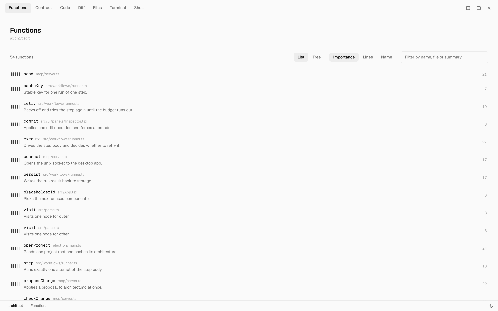
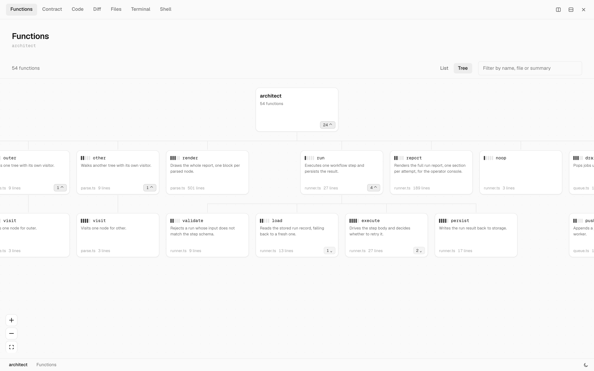
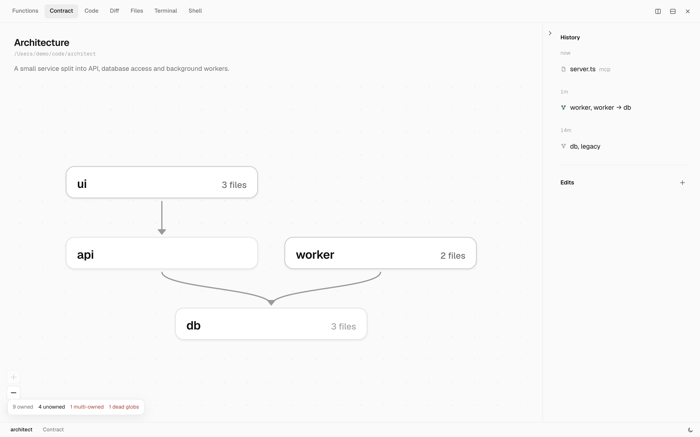
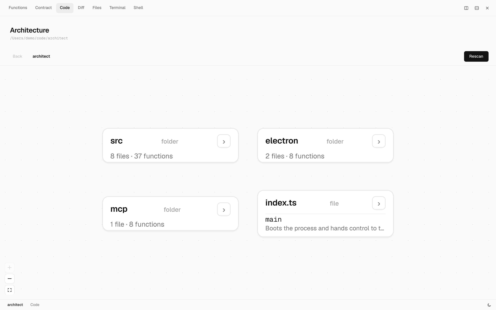
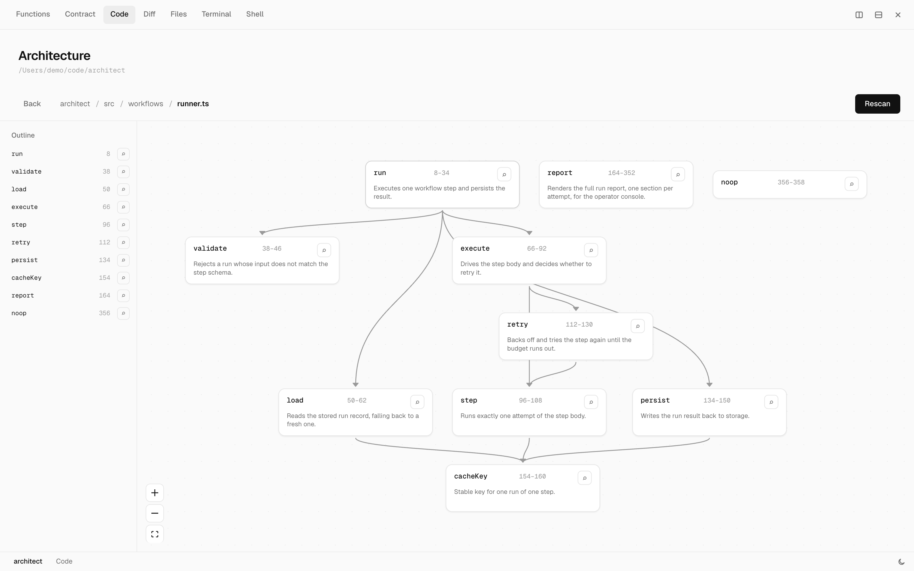
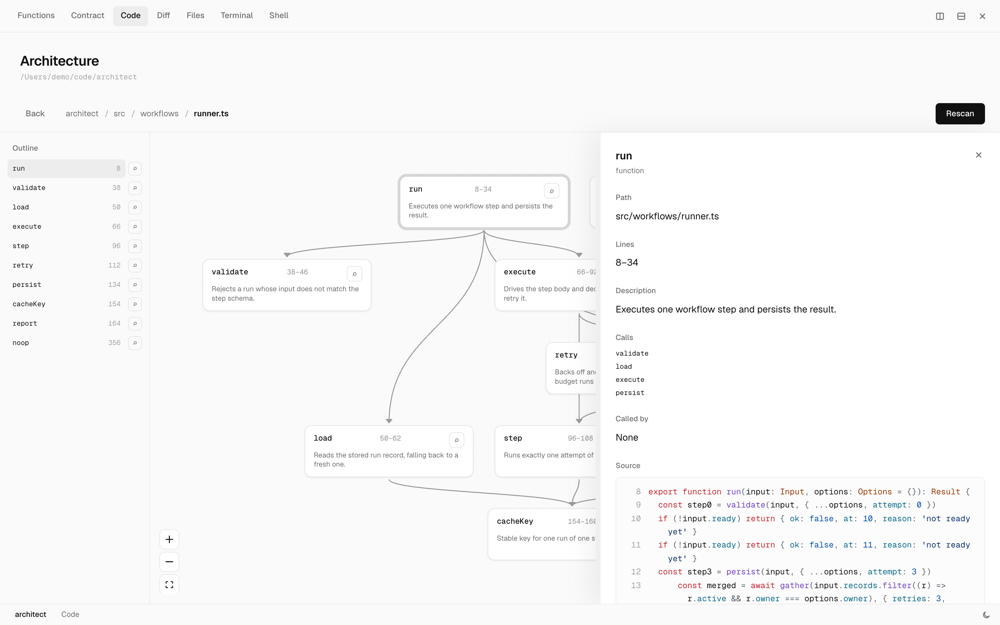

<div align="center">

# Architect

**Draw your architecture. Make your AI follow it.**

Coding agents generate structure faster than anyone reviews it. Architect puts the engineer back in control: you draw the system, the agent has to read it, and every structural change it makes lands on your canvas live, highlighted as it arrives and kept in a history.

[](LICENSE)
[](https://modelcontextprotocol.io)

</div>

---

## What's new: the Functions tab

Open a project and Architect now starts on **Functions**: every function in the repo, with its line count, an importance score from 1 to 5, and a one line description.

- **Ranked without AI.** Importance comes from PageRank over the call graph plus plain facts such as whether a function is exported or is a starting point. Descriptions come from the author's comments, or from the function name when there are none. No API key, no model call, about 3 ms for 1,300 functions.
- **List view.** Sort by importance, lines or name, and filter by name, file or description.
- **Tree view.** An org chart of who calls whom, from the starting points down. Open and close branches, search, and zoom.

Architect no longer drafts an `architect.md` on its own. The Draft button on the Contract tab still does it when you ask.

<picture>
  <source media="(prefers-color-scheme: dark)" srcset="docs/screenshots/functions-list-dark.png">
  
</picture>

*Every function, ranked by importance, with its description and line count.*

<picture>
  <source media="(prefers-color-scheme: dark)" srcset="docs/screenshots/functions-tree-dark.png">
  
</picture>

*The Tree view, from the project down through the functions each one calls.*

## What it looks like



*The architecture as you drew it, reading top to bottom.*



*Code mode drops the contract and reads the repo as it actually is, folder by folder.*



*Descend into a file and its functions become the graph, with the calls between them as edges.*



*Pick a function to get its callers, its calls and its source without leaving the canvas.*

## The problem

Left alone, an agent invents a new service, a new util layer, a new dependency and a new folder nobody asked for. Each one is defensible on its own. Together they are how a clean codebase becomes unreviewable in a week.

Telling the agent "follow the architecture" in a prompt does not hold. Prompts are advice. Architect makes it a gate.

## How it works

You draw the architecture once, as boxes and arrows. Each box claims part of the repo with a glob, which is what turns a drawing into a contract.

Then the agent has to live inside it:

```
claude: check_change({ from: 'api', to: 'billing' })
        -> ALLOWED            the edge is drawn, answered instantly, you are not interrupted

claude: check_change({ from: 'ui', to: 'db' })
        -> FORBIDDEN          "the ui goes through api, it never touches the database directly"

claude: check_change({ from: 'api', to: 'search' })
        -> UNKNOWN-COMPONENT  'search' is not on the canvas, it proposes the component

claude: propose_change({ kind: 'component', id: 'search', ... })
        -> APPROVED           written to architect.md at once

claude: check_change({ from: 'ui', to: 'billing' })
        -> UNDRAWN-EDGE       both components exist, no edge between them, it proposes the edge

claude: propose_change({ kind: 'edge', from: 'ui', to: 'billing', ... })
        -> APPROVED           written to architect.md at once
```

By default there is no approval step (turn on [change review](#change-review) if you want one). The change lands in `architect.md` immediately and shows up on your canvas as it happens, with new components and edges highlighted as they arrive. Every change, to the contract or to the code, is kept in a history you can scroll back through. A change that would close a cycle, name an unknown component or cross a forbidden rule is rejected with the reason, and the file is left alone.

**You never read a text diff. You watch a picture of your system change.**

## Change review

Change review is off by default. Turn it on with the **Review** switch in the status bar, or **Toggle change review** in the command palette (Space), and Claude has to wait for you:

- Every `propose_change` waits in Architect instead of being written. Proposals that would close a cycle, name an unknown component or cross a forbidden rule are still rejected at once, without bothering you.
- Every `Edit`, `Write` and `MultiEdit` Claude Code makes to a file inside a project open in Architect waits too, through a `PreToolUse` hook.

The **Review** tab lists what is waiting. For each change it shows where it lands on the architecture (new components and edges dashed, removed ones struck through in red, and the component that owns an edited file highlighted), which functions in that file are added, removed or changed and how many other functions call them, and the before and after diff. You can **Approve**, **Deny**, or **Suggest a better way**: what you type goes back to Claude as the reason, so it can try again your way.

A contract proposal nobody answers in 5 minutes comes back to Claude as pending with an id it can keep waiting on with `await_proposal`, and pending proposals survive a restart in `~/.architect/pending.json`. A code edit nobody answers in 9 minutes falls back to Claude Code's own permission prompt. The setting lives in `~/.architect/settings.json`. When review is off, or Architect is not running, or the file is outside every open project, the hook exits at once with no output and Claude Code behaves exactly as it does without Architect.

## What shows up on the canvas

- **A new component.** The largest source of sprawl.
- **A new edge.** How a clean graph quietly becomes a mesh.
- **A new third party package.** The bloatware vector.
- **A file outside every glob.** Sprawl that never shows up as an import.

## The file

Everything lives in one `architect.md` at your repo root. It is readable with no tooling, diffs cleanly, and gets reviewed in a pull request like any other file. The prose above the fold is the whole contract: everything the tool enforces is spelled out in it.

```markdown
## Components

### api
HTTP layer, request validation, auth.
owns: `src/api/**`

## Dependencies

- api -> billing

## Forbidden

- ui -> db : the ui goes through api, it never touches the database directly
```

Node positions trail the document in an HTML comment, one `id: x,y` per line. They are a hint and nothing else. Anything the block cannot answer for, the graph lays out automatically, so deleting the block or garbling it costs you an arrangement and never a file.

```markdown
<!-- architect:layout
api: 320,40
billing: 320,220
-->
```

Architect ships with its own [`architect.md`](architect.md) describing Architect. It is the demo, the test fixture, and the proof the tool survives contact with itself.

## Install

Architect is an installed desktop app for macOS and Windows, not a browser tab, because it runs in your tray and has to answer the agent the moment it asks.

Until the first packaged release, build and install it from source:

```bash
npm install
npm run install:local
```

That installs the app and writes the MCP bridge to `~/.architect/bin/architect-mcp.mjs`, outside the app bundle, because Node cannot execute a file inside `app.asar`. If that file is missing, `npm run install:local` has not run yet and no client can reach Architect.

For Claude Code, the install also registers the bridge (`claude mcp add --scope user architect`) when the `claude` CLI is present, and merges three hooks into `~/.claude/settings.json`: `SessionStart`, `PostToolUse` on `Edit|Write|MultiEdit|NotebookEdit`, and `PreToolUse` on `Edit|Write|MultiEdit` with a 600 second timeout for [change review](#change-review). All three run `node ~/.architect/bin/architect-mcp.mjs hook`. Existing hooks are kept and reinstalling never duplicates them. With these in place every Claude Code session opens an Architect tab bound to the folder it works in (or the matching folder of a worktree it edits), and that tab rescans and marks each edited file live. The hook exits at once and stays silent when Architect is not running.

Other clients register the bridge by hand.

Claude Code, if the CLI was not on your PATH during install:

```bash
claude mcp add --scope user architect -- node ~/.architect/bin/architect-mcp.mjs
```

Claude Desktop, merged into `claude_desktop_config.json`, then restart it. Neither it nor Codex expands `~`, so write the absolute path:

```json
{
  "mcpServers": {
    "architect": {
      "command": "node",
      "args": ["/Users/you/.architect/bin/architect-mcp.mjs"]
    }
  }
}
```

Codex, appended to `~/.codex/config.toml`:

```toml
[mcp_servers.architect]
command = "node"
args = ["/Users/you/.architect/bin/architect-mcp.mjs"]
```

One registration covers every repo. The bridge sends its working directory with each call, and Architect walks up from there to find `architect.md`, so the right project resolves automatically. A repo with no `architect.md` gets a clear error rather than silently passing.

The app must be running for the bridge to reach it. It launches at login and lives in your tray.

## Editing architect.md

`npm run build` also produces a language server at `out/lsp/server.js`. Point any LSP client at it and `architect.md` gets diagnostics as you type, completion of component ids on dependency and forbidden lines, go to definition from an edge endpoint to the component that defines it, and rename across every reference including the layout hint.

The server speaks stdio and needs the `--stdio` flag:

```bash
node /path/to/architect/out/lsp/server.js --stdio
```

In Neovim that is `vim.lsp.start({ cmd = { 'node', '/path/to/architect/out/lsp/server.js', '--stdio' }, filetypes = { 'markdown' } })`. In VS Code it is the `serverOptions.command` of a `LanguageClient`. The server only answers for a document named `architect.md`, so pointing it at markdown in general is safe.

## Status

V1 is in active development. It is deliberately small:

**In:** the canvas, the four structural operations, live change highlighting with a history, cycle detection, multi project, and the MCP tools the agent reads and writes the contract through.

**Out, on purpose:** no import verification yet, no drift report, no decision log, no cloud, no accounts. Those are V2, and they are tracked as issues.

## Feedback

I would like to hear what worked and what did not. Reply in the [feedback discussion](https://github.com/abhiramshaji-cyber/Architect/discussions/209), or fill in the short [feedback form](https://github.com/abhiramshaji-cyber/Architect/issues/new?template=feedback.yml).

## Contributing

Ideas are wanted, especially on the open design questions in the issues. See [CONTRIBUTING.md](CONTRIBUTING.md).

## License

Apache 2.0, copyright Abhiram Shaji. Contributions under DCO.
